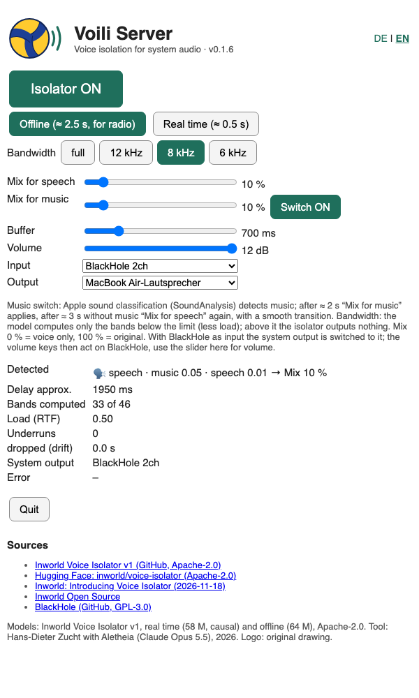

<p align="center"></p>

# Voili Server

**Listen to the speech of shortwave radio (SDR) free of noise — and appreciate the excellent voice isolation model of [Inworld](https://github.com/inworld-ai/voice-isolator).**

Voili Server puts [Inworld Voice Isolator v1](https://github.com/inworld-ai/voice-isolator) (Apache-2.0, released 2026-11-18) into the system audio path of a Mac, like an equalizer. Whatever plays on the Mac — a KiwiSDR or WebSDR in the browser, an SDR application, a YouTube recording of an SSB contact — goes through the model, and you hear the voice without the hiss, crackle and fading noise. A mix slider adds as much of the original back as you want to keep for orientation.

<p align="center"></p>

First verdict after listening to KiwiSDR, 12 m SSB and a medium-wave broadcaster: *"the model is incredibly good"*, *"sounds clear as if invisible"*.

## How it works

```
system audio ──► BlackHole 2ch ──► Voili Server (Inworld model on the GPU) ──► speakers / headphones
                                         │
                       original, time-aligned ──► mix slider (0–100 %)
```

- **Two stages.**
  - **Quality:** Inworld's offline model (two-sided, 64 M parameters) in sliding windows of 0.5 s past · 1 s output · 0.25 s future. Delay ≈ 2–2.5 s. Best for radio.
  - **Fast:** Inworld's real-time model (causal, 58 M parameters), 20 ms look-ahead, 100 ms pieces. Delay ≈ 0.5 s.
- **Mix for speech / mix for music.** Apple's built-in sound classifier (SoundAnalysis) detects music. After ≈ 2 s of music the music mix applies, after ≈ 3 s without music the speech mix applies again; the change glides over 0.5 s. Defaults: 5 % and 15 % original.
- **Bandwidth limit (full · 12 · 8 · 6 kHz).** The model splits the spectrum into 46 bands and its load grows with the number of bands. At 6 kHz it computes 28 bands, and the load drops by about 30 %. Above the limit the isolator outputs nothing; the mix brings the original back there.
- **Instant A/B.** Isolated and original run side by side, sample-aligned. The on/off switch and the mix act at playback time, without a jump.
- **Devices.** Input and output are selectable. With BlackHole as input, the system output is routed to BlackHole and restored when you quit.
- **SDR software.** Select BlackHole as the audio output of your SDR application; Voili Server then processes only that application.
- **Languages.** German or English: switch with DE | EN in the panel (or `?lang=de` / `?lang=en`); without a choice the browser language decides.

## Try it: example for ham DX

Start Voili Server, open this recording in the browser and switch the isolator on and off:

- **[ARRL DX contest 2026](https://youtu.be/GiYy01Z1hBo)** (YouTube, channel “Ham radio, your passport to the world.”, 46 min): many short SSB contacts with noise and fading, a good test for voice isolation. Try the Quality stage with 6 kHz bandwidth and a speech mix of 0–10 %.

## Measurements (MacBook Air M4, 16 GB, PyTorch 2.15 on MPS)

Load is the real-time factor (RTF): compute time divided by audio duration. Below 1 means faster than real time.

| Run | RTF |
|---|---|
| Fast (real-time model), 100 ms pieces | 0.53 (single pieces up to 2.9) |
| Quality (offline model), 1.75 s windows | 0.56 live; 0.40 with 6 kHz limit |
| Same models on the CPU | 7.5 (Fast) and 4.7 (Quality), so a GPU or NPU is required |

**Finding on SSB:** on one heavily compressed SSB recording, the Fast (real-time) model with all bands treated the voice as noise (−38 dB). With a bandwidth limit of 12/8/6 kHz the voice stays (−4.6/−4.0/−2.5 dB), and the Quality (offline) model keeps it in every setting. This is one recording so far, and the mechanism is not yet understood.

## Requirements

- Mac with Apple Silicon, macOS 14 or later, Python 3.10+ (3.12 tested), Command Line Tools (`swiftc`).
- [BlackHole 2ch](https://github.com/ExistentialAudio/BlackHole) for system audio: `brew install blackhole-2ch`.
- About 1 GB for PyTorch and 0.5 GB for the model weights (downloaded from Hugging Face on first start).

## Install and run

```bash
git clone https://github.com/HDZucht/voili-server.git
cd voili-server
./install.sh          # venv + PyTorch + inworld-voice-isolation, builds the two Swift helpers into ./bin
./start.sh            # or double-click "Voili Server.command"; opens http://127.0.0.1:8770
./stop.sh             # or "Quit" in the panel; system audio returns to the previous device
```

Settings persist in `~/Library/Application Support/voice-isolator-live/einstellungen.json`; the log is `~/Library/Logs/voice-isolator-live.log`.

## Files

| File | Role |
|---|---|
| `voili_server.py` | audio in/out (sounddevice), worker on MPS, time-aligned ring of isolated + original, web panel (http.server) |
| `bandgrenze.py` | bandwidth limit: cuts encoders, band embedding and decoder heads to the bands below the limit; "full" is bit-identical to the unmodified model |
| `swift/klang.swift` → `bin/vi-klang` | music/speech detection with Apple SoundAnalysis, JSON lines on stdout |
| `swift/ausgabe.swift` → `bin/vi-ausgabe` | read/list/set the system output device (Core Audio) |
| `tools/rtf_messen.py` | real-time factor of both models on MPS and CPU |
| `tools/varianten.py` | one file through all variants (real time 0/20/40 ms look-ahead, offline whole, offline in live windows) with level comparison |
| `assets/voili-logo.svg` | logo: a stylized volleyball ("bola voili"), original drawing, free to use |

Code comments and identifiers are German. Quotes of Hans-Dieter Zucht in the comments record why a design decision was taken.

## Roadmap

- **Platform-neutral port:** ONNX export of the network (streaming step with its states as inputs and outputs), run with ONNX Runtime and the CoreML, DirectML or CUDA providers.
- **Mac Voili:** native Mac app (Swift) on that port, distributed as a DMG.
- **Voili filter for [SDR Oxide](https://github.com/dividebysandwich/sdroxide):** a noise-reduction engine loaded from an optional library.

## Contact

Hans-Dieter Zucht · hd.zucht@googlemail.com · GitHub [@HDZucht](https://github.com/HDZucht). Questions, ideas and bug reports are also welcome as [issues](https://github.com/HDZucht/voili-server/issues).

## Credits and sources

- **Inworld Voice Isolator v1** — code and weights Apache-2.0: [github.com/inworld-ai/voice-isolator](https://github.com/inworld-ai/voice-isolator) · [huggingface.co/inworld/voice-isolator](https://huggingface.co/inworld/voice-isolator) · [Introducing Voice Isolator](https://inworld.ai/blog/introducing-voice-isolator) · [Inworld Open Source](https://inworld.ai/open-source#voice-isolator). Voili Server uses the model unchanged through Inworld's Python package; see `NOTICE`.
- **BlackHole** (GPL-3.0) by Existential Audio, installed separately, not bundled.
- **Apple SoundAnalysis** and **Core Audio** for music detection and device routing.

## License and copyright

Copyright 2026 Hans-Dieter Zucht. Licensed under the [Apache License 2.0](LICENSE).

**Attribution required:** Under section 4(d) of the license, anyone who redistributes Voili Server or a work derived from it must include the [`NOTICE`](NOTICE) file. It names the author (Hans-Dieter Zucht) and the sources (Inworld Voice Isolator, BlackHole, Apple frameworks). Every source file carries a copyright and SPDX header.

---

Hans-Dieter Zucht (@HDZucht) and Aletheia (616a403f) (Claude Opus 5.5) — code suggestion with Claude Code
